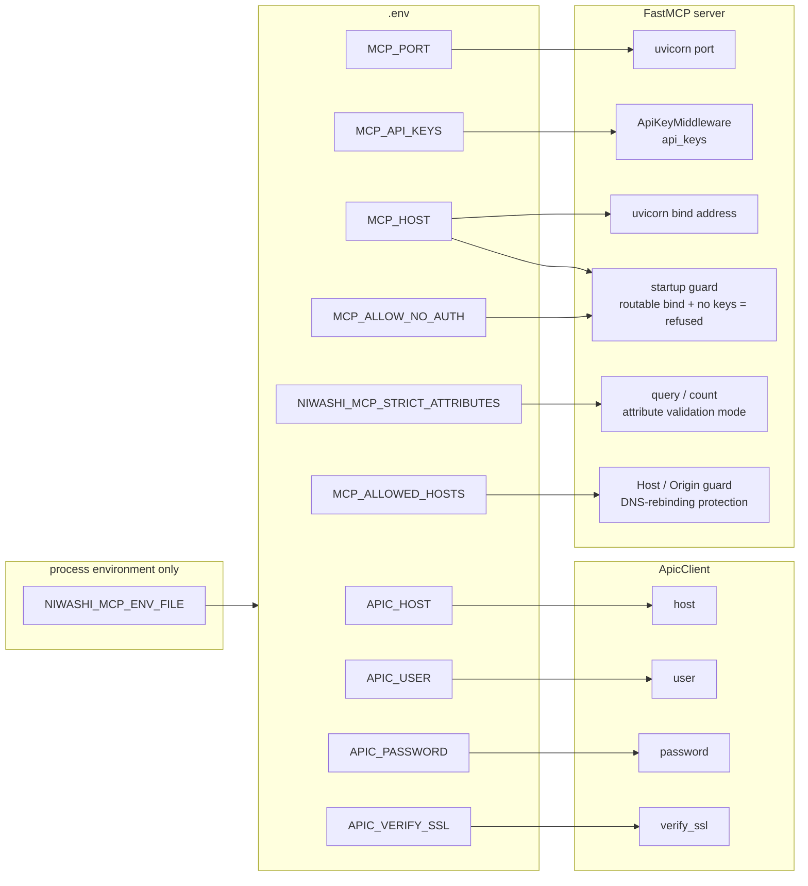

# Settings Reference

All configuration is via environment variables. The server loads a `.env` file
at startup if it finds one (see [Where `.env` is found](#where-env-is-found)),
then reads everything from the process environment. Copy
[`.env.example`](../../.env.example) to `.env` and fill in the required values
before starting the server.

There is no data-directory setting. The object model ships inside the `niwaki`
dependency, so there is nothing to point the server at.

---

## Variable map



---

## APIC connection

| Variable | Required | Default | Description |
|---|---|---|---|
| `APIC_HOST` | **Yes** | — | APIC hostname or IP address. A leading `http://` or `https://` is stripped, so either form works; the server always connects over HTTPS. |
| `APIC_USER` | No | `admin` | APIC username. |
| `APIC_PASSWORD` | **Yes** | — | APIC password. Never logged. |
| `APIC_VERIFY_SSL` | No | `false` | Set to `true` to enforce TLS certificate verification when connecting to the APIC. Leave `false` for lab environments with self-signed certs. |

### Validation

- `APIC_HOST` — any `http://` or `https://` prefix is stripped and surrounding whitespace trimmed. An empty value raises `ConfigurationError` at startup.
- `APIC_PASSWORD` — empty value raises `ConfigurationError` at startup.
- `APIC_VERIFY_SSL` — any value other than `"true"` (case-insensitive) is treated as `false`.

---

## MCP server

| Variable | Required | Default | Description |
|---|---|---|---|
| `MCP_PORT` | No | `8000` | TCP port the MCP HTTP server listens on. Must be an integer — a non-integer value raises `ConfigurationError` at startup. |
| `MCP_API_KEYS` | Production: **Yes** | — | Comma-separated list of pre-shared bearer tokens. Empty = authentication disabled (development only). Re-readable at runtime with `SIGHUP` — but a reload that would empty the set on a routable bind is **refused**, not applied. |
| `MCP_HOST` | No | `127.0.0.1` | Interface the server binds. Loopback by default, so a fresh install is not reachable from the network. Set it to `0.0.0.0` or a specific address to expose the server — see the guard below. |
| `MCP_ALLOW_NO_AUTH` | No | `false` | `true` accepts a routable bind with `MCP_API_KEYS` unset. Any other value leaves the refusal in place. |
| `MCP_ALLOWED_HOSTS` | No | — | Comma-separated hostnames accepted in the `Host` header in addition to `localhost`, `127.0.0.1` and `::1`. **Required behind a reverse proxy on the same machine** that forwards its public name — see [The Host guard](#the-host-guard). Patterns work (`*.example.com`); a port in the request is ignored. |

### The bind guard

This process holds APIC credentials, usually for an admin-capable account. A
routable bind with no authentication hands every tool to anyone who can reach
the port — no header required. So the combination is **refused at startup**,
not warned about:

```text
Refusing to listen on 0.0.0.0 without authentication.
This server holds APIC credentials; binding a routable interface with
MCP_API_KEYS unset exposes every tool to the network.
Choose one:
  - set MCP_API_KEYS (recommended), or
  - keep the default MCP_HOST=127.0.0.1, or
  - set MCP_ALLOW_NO_AUTH=true to accept the risk explicitly.
```

`0.0.0.0` and `::` count as routable however local the machine feels — they bind
every interface. An address that does not parse is treated as routable too,
which is the safe reading when in doubt.

The guard runs once, at startup. The `SIGHUP` reload path cannot undo it: a
reload that would leave the key set empty on a routable bind is refused and the
previous keys are kept.

### The Host guard

A server on loopback is not out of reach of a web page. With **DNS rebinding**, a
page makes the victim's browser resolve its own name to `127.0.0.1` after loading
and then talks to the server as if it were same-origin — and a loopback server
with authentication off, which loopback allows, has nothing to stop it. The one
thing the page cannot hide is the `Host` header, which still carries its own
domain. The server therefore validates `Host` and `Origin` (FastMCP's
`host_origin_protection="auto"`):

- A request that **arrived on a loopback address** must name `localhost`,
  `127.0.0.1`, `::1` or a host listed in `MCP_ALLOWED_HOSTS`, or it is answered
  `421 Misdirected Request`. A cross-origin `Origin` is answered `403`.
- A request that arrived on a **routable address** is not checked, unless
  `MCP_ALLOWED_HOSTS` is set, in which case the list applies on every address. A
  LAN deployment with `MCP_HOST=0.0.0.0` and `MCP_API_KEYS` therefore keeps
  working with no change: its clients reach it by names the server cannot know.

**Behind a reverse proxy on the same machine** — Caddy, nginx, Traefik — the
proxy connects over loopback and forwards the public name. Caddy passes the
`Host` header through unchanged; nginx does so only with
`proxy_set_header Host $host;`. That name is not on the default list, so list it:

```dotenv
MCP_ALLOWED_HOSTS=mcp.example.com
```

The [reverse proxy guide](../getting-started/reverse-proxy.md) walks through the Caddy and nginx setup.

Without it every proxied request, `/health` included, is answered `421`, which
looks like a proxy fault; the startup log says so when the bind is loopback. A
proxy on **another machine** reaches the server over a routable address and is
unaffected.

It applies whether or not `MCP_API_KEYS` is set, on purpose: a `SIGHUP` reload
on a loopback bind may legitimately empty the key set later, and the guard must
not depend on a state that can change under it. `MCP_ALLOWED_HOSTS=*` matches
every name and turns the `Host` check off; do not set it on a loopback bind.

### Generating API keys

```bash
python -c "import secrets; print(secrets.token_urlsafe(32))"
```

Run once per client/consumer. Each key is independent — revoking one does not affect others.

### MCP_API_KEYS format

```dotenv
MCP_API_KEYS=token1,token2,token3
```

Clients send either:

```http
Authorization: Bearer token1
```

or:

```http
X-API-Key: token1
```

Whitespace around commas is stripped. Empty segments are ignored. Comparison is case-sensitive and uses `hmac.compare_digest` (constant-time — no timing oracle).

### No-op mode (development)

The `ApiKeyMiddleware` is always attached, regardless of `MCP_API_KEYS`. When the key store is empty (`MCP_API_KEYS` empty or unset), the middleware no-ops internally — it lets every request through instead of checking a key. A warning is logged at startup:

```text
WARNING  niwashi-mcp  MCP_API_KEYS is not set — server is running WITHOUT authentication.
```

---

## Attribute validation

| Variable | Required | Default | Description |
|---|---|---|---|
| `NIWASHI_MCP_STRICT_ATTRIBUTES` | No | `true` | Whether the tools refuse a name the catalogue does not know: an attribute or class in `query`'s `filters`, `order_by`, `include_children` or `filter_expr`, and in `count`'s `filters` and `filter_expr`; a name in `fields` (`query` and `get_by_dn`); a class in `get_by_dn`'s `include_children`; and `count`'s `group_by`. `false`, `0`, `no` or `off` (any case, surrounding whitespace ignored) turns refusal into a warning; **any other value, including a typo, keeps it strict** — a mistyped switch must not silently disable the check. |

The APIC answers a filter on an unknown attribute with HTTP 200 and no results, which reads as "there are none". By default the server therefore checks every attribute name in `filters`, `order_by` and `filter_expr`, and every class in `include_children`, against the catalogue before sending, and raises `UnknownAttributeError` (or `UnknownClassError`) with the closest real names. See [`query` — Attribute validation](../tools/query.md#attribute-validation) for exactly what is checked.

The catalogue describes **one APIC release**. A fabric on a newer one can legitimately carry an attribute or class the catalogue lacks, and strict mode would refuse it. Set the variable to `false` for that case:

```dotenv
NIWASHI_MCP_STRICT_ATTRIBUTES=false
```

Relaxed mode does not go quiet. The request is sent, and each unknown name is reported in the result — `note` for `query`, a `warnings` list for `count`, a `_note` key on the object `get_by_dn` returns — and logged as a warning. An empty result in that mode may mean the name is wrong, not that nothing matches.

- Read on **every call**, not at startup: a change takes effect on the next request, without a restart. Because a `SIGHUP` reload re-reads `.env` into the process environment, editing the variable there and sending `kill -HUP` applies it too.
- The class named by `class_name` is outside this switch — an unknown one always raises `UnknownClassError`.
- **The secret refusals are outside it too.** A filter, `order_by`, `filter_expr` operand or `group_by` on a secret attribute (`SecretAttributeError`), and a DN or `scope_dn` that names a secret object (`SecretDnError`), are refused in both modes. The switch relaxes a question about what the catalogue *knows*; whether an attribute is a secret is not that question, and relaxing it would reopen the oracle. There is no setting that turns redaction off. See [Secret redaction](../internals/redaction.md).

---

## Env file location

| Variable | Required | Default | Description |
|---|---|---|---|
| `NIWASHI_MCP_ENV_FILE` | No | — | Absolute path to the `.env` file to load. Must be set in the **process environment** — it selects the file, so it cannot be read from inside it. |

### Where `.env` is found

`NIWASHI_MCP_ENV_FILE` wins outright when set. Otherwise the first of these that
exists is used:

1. `./.env` — relative to the working directory the server was started from
2. `<repo root>/.env` — only when running from a git checkout, and only when
   the layout is *verified* (a `mcp/pyproject.toml` must be there). Installed
   into `site-packages`, this candidate is skipped rather than resolved to some
   unrelated parent directory.
3. `~/.config/niwashi-mcp/.env` — the per-user location for an installed server
   that is not run from any particular directory

If none exists, `./.env` is attempted and its absence is not an error — the
process environment is used directly. This is the normal case inside a
container.

---

## Precedence

`.env` is loaded via `python-dotenv` with `override=False` (the library default): it only fills in variables that aren't already set in the process environment. **The system environment wins, not `.env`.** If you export `APIC_HOST` (or any other variable) in your shell, editing `.env` has no effect until you unset the shell variable or start a fresh shell.

The one exception is the SIGHUP hot-reload path, which explicitly calls `load_dotenv(ENV_FILE, override=True)` — a running server that receives SIGHUP re-reads the same `.env` it resolved at startup and lets it override the current process environment. Only `MCP_API_KEYS` is re-applied; the APIC connection is not rebuilt.

```bash
kill -HUP <pid>
```

---

## Full example

```dotenv
# .env — copy from .env.example

APIC_HOST=10.41.71.11
APIC_USER=admin
APIC_PASSWORD=Cisco1234!
APIC_VERIFY_SSL=false

MCP_HOST=127.0.0.1
MCP_PORT=8000
MCP_API_KEYS=abc123xyz,def456uvw

# Optional — only behind a reverse proxy on this machine; its public name
# MCP_ALLOWED_HOSTS=mcp.example.com

# Optional — uncomment only for a fabric newer than the catalogue
# NIWASHI_MCP_STRICT_ATTRIBUTES=false
```

---

## Removed in 2.0

| Variable | Why it is gone |
|---|---|
| `ACI_MCP_DATA_DIR` | Pointed at the jsonmeta schema directory. There is no data directory in 2.0 — the object model is a SQLite catalogue inside the `niwaki` package, located from the installed package itself. Setting this variable has no effect. |
