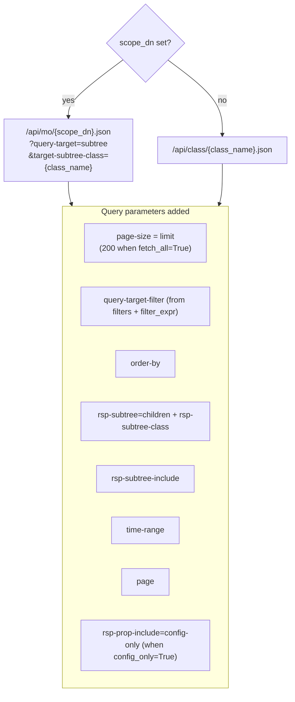

# Tool: query

Execute a filtered class query against the APIC. **Only call this after `search_classes` and `get_schema`.**

Every attribute name in the request is checked against the catalogue **before** it is sent — see [Attribute validation](#attribute-validation).

---

## Signature

```python
query(
    class_name: str,
    filters: dict[str, str] | None = None,
    scope_dn: str | None = None,
    limit: int = 20,
    order_by: str | None = None,
    include_children: list[str] | None = None,
    filter_expr: str | None = None,
    rsp_subtree_include: str | None = None,
    time_range: str | None = None,
    page: int | None = None,
    config_only: bool = False,
    fetch_all: bool = False,
    fields: list[str] | None = None,
) -> QueryEnvelope
```

**Returns an envelope dict, not a bare list** — see [Return value](#return-value) below. This is a breaking-looking change for any code written against an older version of this doc: `result["results"][0]["dn"]`, not `result[0]["dn"]`.

---

## Parameters

### Required

| Parameter | Type | Description |
|---|---|---|
| `class_name` | `str` | Exact ACI class name — **must** be verified with `search_classes()` first |

### Filtering

| Parameter | Type | Default | Description |
|---|---|---|---|
| `filters` | `dict[str, str]` | `{}` | Simple equality filters `{attr: value}`. Keys must be valid property names from `get_schema()` — an unknown one raises `UnknownAttributeError`. Multiple entries are combined with APIC `and()`. |
| `filter_expr` | `str` | — | Raw APIC filter for complex predicates. Combined with `filters` via `and()` when both set. Each `Class.attr` operand is checked against the catalogue; see [Attribute validation](#attribute-validation). |

### Scoping

| Parameter | Type | Default | Description |
|---|---|---|---|
| `scope_dn` | `str` | — | DN of a parent object. Restricts the query to a subtree — faster than a fabric-wide scan on large deployments. |

### Pagination and ordering

| Parameter | Type | Default | Description |
|---|---|---|---|
| `limit` | `int` | `20` | Maximum objects to return per page. Clamped to `[1, 200]` — values below 1 are raised to 1 rather than passed to the APIC as an invalid page-size. Not used when `fetch_all=True`, which pages at its own fixed size of 200 whatever `limit` is. |
| `page` | `int` | — | 0-based page number for paginated result sets. Ignored when `fetch_all=True`. |
| `order_by` | `str` | — | APIC ordering expression, e.g. `"faultInst.severity\|desc"`. The attribute is checked against the class named in the term. |
| `fetch_all` | `bool` | `False` | Walk every page (200 objects per page, independent of `limit`) and return the complete matching set in one call — the reliable way to answer a max/min/total/all-of question over a whole class instead of paging manually. Holds at most 5,000 objects (25 pages): a set of 5,000 or fewer comes back whole with `complete` `True`, a larger one comes back as its first 5,000 with `complete` `False` and `total_available` still the true size — nothing beyond the cap is fetched. `complete` is also `False` if the APIC ends its pages before the `totalCount` it reported. Narrow the query (e.g. `scope_dn`) and combine results. |

### Children and subtrees

| Parameter | Type | Default | Description |
|---|---|---|---|
| `include_children` | `list[str]` | — | Child class names to embed inline. Each result dict gains a `_children` key. An unknown class raises `UnknownClassError`. |
| `rsp_subtree_include` | `str` | — | Subtree categories: `"faults"`, `"health"`, `"audit-logs"`, `"faults,no-scoped"`, `"faults,required"`. |

### Attribute projection

| Parameter | Type | Default | Description |
|---|---|---|---|
| `config_only` | `bool` | `False` | When `True`, return only user-configurable attributes (APIC `rsp-prop-include=config-only`) instead of the full ~40-attribute set. Ideal for comparison, drift detection, and backup — drops runtime state, timestamps, and monitoring counters. |
| `fields` | `list[str]` | — | Attribute names to keep, e.g. `["name", "arpFlood"]`. Each result **and each `_children` entry** is reduced to these plus `dn`, `_class` and `_children`, which are always kept. See [Field projection](#field-projection). |

### Time-based queries

| Parameter | Type | Description |
|---|---|---|
| `time_range` | `str` | For log record classes (`faultRecord`, `aaaModLR`, `eventRecord`, `healthRecord`). Examples: `"24h"`, `"1week"`, `"2026-01-01\|2026-01-31"`. |

---

## Return value

An **envelope dict** — not a bare list:

```json
{
  "results": [
    {
      "_class": "fvBD",
      "dn": "uni/tn-OT/BD-servers",
      "name": "servers",
      "arpFlood": "no",
      "unicastRoute": "yes",
      "_children": [
        {
          "_class": "fvSubnet",
          "dn": "uni/tn-OT/BD-servers/subnet-[10.0.1.0/24]",
          "ip": "10.0.1.1/24"
        }
      ]
    }
  ],
  "returned": 1,
  "total_available": 1,
  "truncated": false,
  "next_page": null,
  "complete": true,
  "note": null,
  "fields": null
}
```

| Field | Type | Description |
|---|---|---|
| `results` | `list[dict]` | The objects themselves — each dict has all APIC attributes, a `"_class"` key, an always-present `"dn"`, and `"_children"` when `include_children` is set. Same per-object shape as before; the change is the wrapper around it. |
| `returned` | `int` | `len(results)` |
| `total_available` | `int` | True match count, fabric- or subtree-wide — independent of how many were actually fetched |
| `truncated` | `bool` | `total_available > returned` — a default-page result is a **partial page**, not the whole matching set. Never conclude a max/min/total/complete-list answer from a truncated result. |
| `next_page` | `int \| None` | `page + 1` when truncated and `fetch_all` was not used; `None` otherwise |
| `complete` | `bool` | `False` only if `fetch_all=True` stopped short of `total_available` — at the 5,000-object cap, or because the APIC ended its pages before the `totalCount` it reported. A set of exactly 5,000 objects is complete. |
| `note` | `str \| None` | Guidance text — set when truncated or capped, and when [relaxed attribute checking](#relaxing-the-check) sent a name the catalogue did not know (in `filters`, `order_by`, `include_children`, `filter_expr` or `fields`). When several apply they are joined into one string, the truncation or cap note first, never replacing it. |
| `fields` | `list[str] \| None` | The projection that was applied, echoed as given; `None` when `fields` was not set. Added in this release: every envelope now carries it, `null` by default — the one change to an unprojected result. |

The envelope is a typed dict (`QueryEnvelope`), so the `outputSchema` the server advertises names these keys, marks all of them required, and admits `null` for `next_page`, `note` and `fields`. `results` items stay free-form objects: which attributes an object carries depends on its class.

Any code written against the older (pre-envelope) shape of this doc needs updating: `result["results"][0]["dn"]`, not `result[0]["dn"]`.

---

## Raises

| Exception | Condition |
|---|---|
| `UnknownClassError` | `class_name` is not in the catalogue — the single source of truth for whether an ACI class exists (15,452 classes). Includes `.suggestions` (list, drawn from the search index) and `.registry_size` (int — the 15,239-entry search index, which is smaller than the validated universe). The 213 catalogue classes absent from the search index validate normally: 2.0 removed the two-tier fallback and the warning it used to emit on them. Also raised for an unknown class in `include_children`, or as the `Class` of a `Class.attr` operand in `filter_expr` or `order_by` (the same error, built the same way). |
| `UnknownAttributeError` | An attribute in `filters`, `order_by` or `filter_expr` is not a property of its class in the catalogue, or a name in `fields` is not a property of `class_name` nor of any class in `include_children`. Carries `.class_name`, `.attribute`, `.suggestions` (the closest real property names — a case-only difference first) and `.catalogue_version`. Nothing has been sent to the APIC when it is raised. With `NIWASHI_MCP_STRICT_ATTRIBUTES=false` it is not raised: see [Relaxing the check](#relaxing-the-check). |
| `FilterError` | `class_name` or a `filters` key contains characters outside the expected ACI identifier format. Filter *values* are always escaped, never rejected — this can only be raised by an identifier, not a value. |
| `ApicRequestError` | APIC returned a non-2xx, non-auth response — e.g. 400 for a malformed `filter_expr`, or a transient 5xx that never recovered. Carries the HTTP status and, when present, the APIC error text. |

---

## Attribute validation

The APIC answers a filter on a misspelled or invented attribute with HTTP 200 and `[]` — indistinguishable from "there are none". So before a request is built, `query` checks four things against the catalogue, for the class they belong to:

| Source | What is checked | Raises |
|---|---|---|
| `filters` | every key, against `class_name` | `UnknownAttributeError` |
| `order_by` | the attribute of each `Class.attr[\|asc\|desc]` term (terms may be comma-separated), against the class **in the term** | `UnknownAttributeError`, or `UnknownClassError` if the term's class is unknown |
| `include_children` | every class name (an item may itself be comma-joined, as the APIC takes it) | `UnknownClassError` |
| `filter_expr` | the `Class.attr` operand of each predicate, against `Class` | `UnknownAttributeError`, or `UnknownClassError` if `Class` is unknown |

In strict mode (the default) the **first** problem raises and no request reaches the backend. The error carries the closest real names, so the caller can correct itself without a `get_schema()` round-trip.

Details worth knowing:

- **Abstract classes** accept the union of their own properties and those of every concrete subclass. A query on `fvABD` returns `fvBD` instances, so `hostBasedRouting` (declared by `fvBD`, not `fvABD`) is valid there.
- **System attributes** — `dn`, `rn`, `status`, `lcOwn`, `modTs` and the rest — are in the catalogue like any other property, so `wcard(fvBD.dn,"...")` passes.
- **Quoted values are never inspected.** `wcard(fvBD.dn,"uni/tn-a.b.c")` holds `a.b` inside a string literal; it is a value, not a `Class.attr`. Escaped quotes inside a literal are honoured, and a literal that never closes is treated as running to the end.
- **Only the first operand of a predicate is an attribute reference** (`eq(fvBD.name,"x")`, `bw(faultInst.severity,"a","b")`, nested under `and`/`or`/`not` as deeply as you like). Anything the extractor does not recognise as `Class.attr` — a bare `name`, a malformed expression — is sent exactly as written, and the APIC remains the judge of it.
- **`filters` keys that are not identifiers** (`bad-attr`, `123attr`) are left to `build_filter`, which raises `FilterError` for them as before.
- The check is against **one APIC release** (the catalogue's — `UnknownAttributeError.catalogue_version`). A fabric on another release may carry an attribute or class the catalogue lacks; see below.

### Relaxing the check

Set `NIWASHI_MCP_STRICT_ATTRIBUTES=false` (see [Settings](../configuration/settings.md#attribute-validation)) and the same checks run but **nothing is raised**: the request is sent, and every problem is surfaced in two places so it is never silent —

- the result's `note`, appended to any truncation or cap note rather than replacing it;
- a `ctx.warning` log entry per problem.

```json
{
  "results": [],
  "returned": 0,
  "total_available": 0,
  "truncated": false,
  "next_page": null,
  "complete": true,
  "note": "filters: Unknown attribute 'newAttr' on ACI class 'fvBD'. No close matches found. Call get_schema('fvBD') to list its attributes. The catalogue describes APIC 6.0(9c); a fabric on another release may legitimately have this attribute. Sent anyway because strict attribute checking is off — an empty result may mean this name is wrong, not that nothing matches."
}
```

An empty result next to such a note is **not** an answer of zero. The class named by `class_name` itself is outside this switch: an unknown one always raises.
## Field projection

A wide class carries ~40 attributes per object. `fields` cuts each object down to the few the caller will read, so more objects fit in one answer:

```python
bds = await query("fvBD", scope_dn="uni/tn-OT", fields=["name", "arpFlood"])
# every result: {"name": ..., "arpFlood": ..., "dn": ..., "_class": "fvBD"}
```

- **Always kept:** `dn`, `_class` and `_children`. Naming them in `fields` is accepted and changes nothing.
- **Children are projected too.** With `include_children`, each `_children` entry is reduced by the same list, so one flat list serves both levels. This includes children that arrive through `rsp_subtree_include`.
- **Validation.** Every name must be a property of `class_name` *or* of at least one `include_children` class — a name valid only on the child is accepted, because the list is applied to both. Anything else raises `UnknownAttributeError` with the closest matches, before the request is sent; without that check a misspelled field would return objects that merely lack the key, which reads as "the attribute is empty".
- **Empty list.** `fields=[]` keeps only `dn`, `_class` and `_children`, and the `note` says so. Omit `fields` to receive every attribute — the two are not the same request.
- **Unchanged:** which objects match, `returned`, `total_available`, `truncated` and paging. Projection runs after the APIC answers, so it saves response size on the way to the agent, not work on the APIC. Key order is the APIC's.
- **Relaxed checking.** With `NIWASHI_MCP_STRICT_ATTRIBUTES=false` an unknown name is kept in the projection, a warning is logged, and the `note` lists it — an attribute missing from the results is then absent from the objects, not empty.

```python
# `ip` belongs to fvSubnet, not fvBD: valid only because fvSubnet is included
bd = await query("fvBD", filters={"name": "servers"},
                 include_children=["fvSubnet"], fields=["name", "ip"])
```

---

## APIC URL construction



---

## Filter syntax

`filters` is converted to APIC `eq()` syntax automatically:

| `filters` dict | Generated filter |
|---|---|
| `{}` | *(no filter parameter)* |
| `{"name": "servers"}` | `eq(fvBD.name,"servers")` |
| `{"name": "servers", "arpFlood": "yes"}` | `and(eq(fvBD.name,"servers"),eq(fvBD.arpFlood,"yes"))` |

`filter_expr` accepts raw APIC predicates for operations not covered by `filters`:

```python
# Objects with severity greater than minor
query("faultInst", filter_expr='gt(faultInst.severity,"minor")')

# Wildcard on DN
query("fvBD", filter_expr='wcard(fvBD.dn,"uni/tn-OT")')

# Not equal
query("fabricNode", filter_expr='ne(fabricNode.role,"controller")')
```

When both `filters` and `filter_expr` are set they are combined:

```python
query("fvBD",
      filters={"unicastRoute": "yes"},
      filter_expr='wcard(fvBD.dn,"uni/tn-OT")')
# → and(wcard(fvBD.dn,"uni/tn-OT"),eq(fvBD.unicastRoute,"yes"))
```

---

## Recipes

### All bridge domains in a tenant

```python
tenants = await query("fvTenant", filters={"name": "OT"})
bds = await query("fvBD", scope_dn=tenants["results"][0]["dn"])
```

### Bridge domain with its subnets and VRF relation

```python
result = await query("fvBD",
    filters={"name": "servers"},
    include_children=["fvSubnet", "fvRsCtx"])
bd = result["results"][0]
```

### Recent faults (last 24 hours)

```python
faults = await query("faultRecord", time_range="24h", order_by="faultRecord.created|desc")
records = faults["results"]
```

### Paginated results

```python
page_0 = await query("faultInst", limit=50, page=0)
page_1 = await query("faultInst", limit=50, page=1)
# page_0["truncated"] / page_0["next_page"] tell you whether to keep paging
```

### Every fault, regardless of page size (fetch_all)

```python
all_faults = await query("faultInst", fetch_all=True)
if not all_faults["complete"]:
    # stopped short (5,000-object cap, or the APIC ended its pages early) —
    # narrow with scope_dn and combine
    ...
count = all_faults["returned"]
```

### Active faults on a specific EPG

```python
epgs = await query("fvAEPg", filters={"name": "web"})
dn = epgs["results"][0]["dn"]
faults = await query("faultInst", scope_dn=dn, rsp_subtree_include="faults,no-scoped")
```

### All fabric nodes (excluding controllers)

```python
nodes = await query("fabricNode",
    filter_expr='ne(fabricNode.role,"controller")',
    order_by="fabricNode.id|asc")
node_list = nodes["results"]
```

### Just names and addresses, over a large class

```python
subnets = await query("fvSubnet", fetch_all=True, fields=["ip", "scope"])
```

### Configuration snapshot for backup / diff

```python
# Only the intended config, no operational churn
bds = await query("fvBD", scope_dn="uni/tn-OT", config_only=True)
config = bds["results"]
```

---

## Performance tips

- Always use `scope_dn` when you know the parent — it issues a subtree query which is faster than a fabric-wide class scan.
- Use `limit` conservatively — the default is 20. Only increase if you know the result set is larger.
- Use `filters` to pre-filter at the APIC level rather than filtering the returned list in code.
